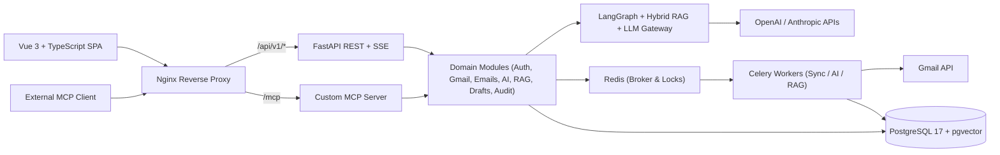

# MailMaster

**An Intelligent AI-Powered Email Management, Knowledge Retrieval, and Workflow Automation Platform.**

[](https://www.python.org/)
[](https://fastapi.tiangolo.com/)
[](https://github.com/pgvector/pgvector)
[](https://vuejs.org/)
[](https://langchain-ai.github.io/langgraph/)
[](https://modelcontextprotocol.io/)
[](./docs/MEMORY.md)

> **Project Status:** MailMaster is currently at the **Phase 0 Documentation & Architecture Baseline** (`v0.1.0-docs`). System architecture, product specifications, engineering rules, UI design tokens, phased implementation tasks, and CI/PR governance are established. Application source code (`backend/`, `frontend/`, `infrastructure/`) is scheduled for implementation starting in [Phase 1 (`MM-101`)](./docs/TASKS.md).

**License:** Pending formal selection in Phase 1 (`MM-101`; MIT License planned).

---

## Project Overview

Conventional email clients bury critical agreements, escalations, and action items inside chronological message lists and weak keyword search. Generic AI email extensions often summarize single messages without cross-thread context, hallucinate answers without citations, and couple tightly to a single LLM vendor.

**MailMaster** solves this with a production-oriented, self-hostable modular monolith that:
- Connects securely to Gmail via Google OAuth 2.0 and performs idempotent incremental synchronization (`historyId`).
- Extracts structured intelligence (priority, category, sentiment, intent, summary, action items) asynchronously via Celery workers.
- Indexes normalized, quote-stripped email chunks into **PostgreSQL 17 + `pgvector` + `tsvector` FTS** for **Hybrid RAG** retrieval with Reciprocal Rank Fusion (RRF) and reranking.
- Orchestrates citation-grounded Q&A and Smart Compose workflows via **LangGraph** and a multi-provider **LLM Gateway** (OpenAI & Anthropic).
- Exposes authenticated email tools, resources, and prompts over a custom **Model Context Protocol (MCP)** Streamable HTTP server.
- Enforces **human-in-the-loop approval** before any email is ever sent.

---

## Core Features (Planned MVP Scope)

*All runtime capabilities below are specified in [docs/PRD.md](./docs/PRD.md) and tracked in [docs/TASKS.md](./docs/TASKS.md); none are claimed as implemented yet.*

- **Intelligent Inbox & Triage:** Priority scoring (`urgent`, `high`, `normal`, `low`), category labeling, sentiment/intent detection, and action-item extraction.
- **Gmail Integration & Incremental Sync:** Least-privilege OAuth 2.0, encrypted tokens at rest, MIME normalization, HTML sanitization (`nh3`), thread reconstruction, and Gmail History API incremental sync.
- **Conversation Summarization:** Automated per-email summaries and on-demand multi-message thread synthesis.
- **Hybrid RAG Retrieval:** Dense `pgvector` HNSW cosine search + PostgreSQL `tsvector` full-text search fused via RRF (`k=60`) and reranked with strict per-account SQL isolation.
- **Multi-Provider LLM Gateway:** Unified adapter abstraction for OpenAI and Anthropic with Pydantic v2 structured outputs, prompt versioning, retries, provider fallback, and token/cost accounting.
- **LangGraph Orchestration:** Explicit `StateGraph` intent routing, context retrieval, response streaming, and citation verification.
- **MCP Integration:** Official Python MCP SDK Streamable HTTP server (`/mcp`) with bearer auth, scoped tools/resources/prompts, and audit logging.
- **Smart Compose & Human Approval:** Context-grounded reply generation with editable drafts and a mandatory `draft` -> `approved` -> `sent` state gate.
- **Docker Compose Deployment:** Single-command topology running PostgreSQL (`pgvector`), Redis, FastAPI, Celery, Vue 3 SPA, and Nginx.

---

## Architecture Highlights

MailMaster uses a **Domain-Oriented Modular Monolith** architecture to preserve ACID transactions, enforce strict account-level isolation, and share services cleanly between the REST API, Celery workers, and MCP server.



See [docs/ARCHITECTURE.md](./docs/ARCHITECTURE.md) for the full component architecture, database ER diagram, RAG pipeline, and security design.

---

## Technology Stack

| Layer | Technologies |
|---|---|
| **Backend & API** | Python 3.12+, FastAPI, Pydantic v2, SQLAlchemy 2.0 (async), Alembic, `httpx`, `nh3` |
| **Database & Cache** | PostgreSQL 17+, `pgvector` (HNSW + `tsvector` FTS), Redis, Celery |
| **AI & RAG** | LangGraph, OpenAI API, Anthropic API, Multi-Provider LLM Gateway, `tiktoken`, Hybrid RRF + Reranking |
| **MCP** | Official Python MCP SDK, Streamable HTTP transport (`/mcp`) |
| **Email** | Gmail API, Google OAuth 2.0, History API incremental sync |
| **Frontend** | Vue 3 (Composition API), TypeScript, Vite, Pinia, Vue Router, Tailwind CSS, `shadcn-vue`, Axios, TanStack Query |
| **Infra & Quality** | Docker, Docker Compose, Nginx, GitHub Actions, Pytest, Vitest, Playwright, Ruff, Mypy, Bandit, `pip-audit`, OpenTelemetry |

---

## Documentation Navigation

| Document | Purpose |
|---|---|
| [docs/PRD.md](./docs/PRD.md) | Product vision, personas, functional/non-functional requirements, MVP acceptance criteria (`AC-01`–`AC-14`), user stories, and roadmap |
| [docs/ARCHITECTURE.md](./docs/ARCHITECTURE.md) | Modular monolith design, Mermaid diagrams, 15-table database schema, sync/AI/RAG/MCP/security architecture, and directory tree |
| [docs/RULES.md](./docs/RULES.md) | Mandatory engineering standards for backend, async, AI/RAG safety, MCP authorization, testing (`>= 90%` branch coverage), and Git |
| [docs/DESIGN.md](./docs/DESIGN.md) | Dark-first UI/UX design system, hex color tokens, typography, 18 component specs, screens, and responsive breakpoints |
| [docs/TASKS.md](./docs/TASKS.md) | Seven-phase dependency-ordered implementation roadmap (`MM-101` through `MM-705`) |
| [docs/MEMORY.md](./docs/MEMORY.md) | Living project journal, verified work tracker, Architectural Decision Records (`ADR-001`–`ADR-006`), and agent handoff guide |

---

## Quick Start (Target Phase 1+ Workflow)

> **Note:** Runtime scaffolding (`MM-101`–`MM-107`) has not been merged yet. The commands below represent the planned local workflow once Phase 1 is complete.

### Prerequisites
- Docker Desktop / Docker Engine + Docker Compose v2
- Python 3.12+ & Node.js 20+ (for local non-container tooling/tests)
- Google Cloud Console OAuth 2.0 Client credentials (Gmail API enabled)
- OpenAI and/or Anthropic API key

### Setup & Startup

```bash
# 1. Clone the repository
git clone https://github.com/anmolvishvas/MailMaster.git
cd MailMaster

# 2. Configure environment variables
cp .env.example .env
# Populate secrets, Google OAuth credentials, and LLM keys in .env

# 3. Start all services (Postgres+pgvector, Redis, Backend, Worker, Frontend, Nginx)
docker compose up --build -d

# 4. Run database migrations
docker compose exec backend alembic upgrade head
```

### Access Points (Planned)
- **Web Dashboard:** `http://localhost`
- **API OpenAPI Docs:** `http://localhost/api/v1/docs`
- **MCP Endpoint:** `http://localhost/mcp` (requires Bearer authentication)

### Gmail OAuth Setup (Google Cloud Console)
1. Create a Google Cloud project and enable the **Gmail API**.
2. Configure the OAuth Consent Screen and add scopes: `gmail.readonly`, `gmail.compose`, `gmail.send`, `openid`, `email`.
3. Create an **OAuth 2.0 Web Application** client with redirect URI `http://localhost/api/v1/gmail/oauth/callback`.
4. Copy `GOOGLE_CLIENT_ID` and `GOOGLE_CLIENT_SECRET` into `.env`.

---

## Environment Variables

*Never commit `.env` or real secrets. All values below are documented for `.env.example` in `MM-101`.*

| Variable | Description |
|---|---|
| `DATABASE_URL` | Async PostgreSQL connection string (`postgresql+asyncpg://...`) |
| `REDIS_URL` | Redis URL for Celery broker, locks, rate limits, and OAuth state |
| `JWT_SECRET_KEY` | High-entropy secret (`>= 32` chars) for signing access JWTs |
| `ENCRYPTION_MASTER_KEY` | 32-byte base64/Fernet key for encrypting OAuth tokens at rest |
| `GOOGLE_CLIENT_ID` / `GOOGLE_CLIENT_SECRET` | Google OAuth 2.0 client credentials |
| `GOOGLE_OAUTH_REDIRECT_URI` | OAuth callback URL matching Google Console configuration |
| `OPENAI_API_KEY` | OpenAI API key for chat/embeddings (optional if using Anthropic + configured embedder) |
| `ANTHROPIC_API_KEY` | Anthropic API key for Claude models |
| `DEFAULT_LLM_PROVIDER` | Primary provider (`openai` or `anthropic`) |
| `EMBEDDING_MODEL` / `EMBEDDING_DIMENSIONS` | Default `text-embedding-3-small` / `1536` |
| `OTEL_EXPORTER_OTLP_ENDPOINT` | Optional OpenTelemetry collector endpoint |

---

## Testing (Planned CI & Local Commands)

Once Phase 1–7 test suites are implemented:

```bash
# Backend linting, formatting & strict typing
cd backend && ruff check . && ruff format --check . && mypy --strict app

# Backend unit, integration, API, MCP & RAG evaluation tests with branch coverage
cd backend && pytest --cov=app --cov-branch --cov-report=xml

# Backend security scans
cd backend && bandit -r app && pip-audit

# Frontend lint, typecheck & unit tests
cd frontend && npm run lint && npx vue-tsc --noEmit && npx vitest run

# End-to-end tests
npx playwright test
```

---

## Project Roadmap

Follow full phase-by-phase progress in [docs/TASKS.md](./docs/TASKS.md):
1. **Phase 1:** Foundation, FastAPI, Vue 3, PostgreSQL/pgvector, Redis, Celery, Docker Compose.
2. **Phase 2:** Auth, rotating refresh tokens, encrypted Google OAuth 2.0, Gmail client.
3. **Phase 3:** Initial & incremental Gmail sync, MIME normalization, Celery intelligence pipeline.
4. **Phase 4:** Multi-provider LLM Gateway, chunking, `pgvector` + FTS hybrid RAG, evaluation harness.
5. **Phase 5:** LangGraph assistant workflow, Smart Compose approval gate, Streamable HTTP MCP server.
6. **Phase 6:** Vue 3 Inbox dashboard, AI chat with clickable citations, Smart Compose UI, settings.
7. **Phase 7:** Rate limiting, chaos/idempotency tests, query benchmarks, OpenTelemetry, E2E, `v1.0.0` release.

---

## Security

MailMaster treats all incoming email content, HTML, headers, and retrieved RAG chunks as **untrusted external input**:
- **Account Isolation:** Every SQL repository and RAG hybrid CTE enforces `user_id` and authorized `account_id` predicates.
- **Credential Protection:** Gmail OAuth tokens are encrypted at rest with versioned authenticated encryption.
- **Prompt Injection Mitigation:** Email payloads are sanitized (`nh3` / `DOMPurify`) and isolated inside explicit XML data fences; LLMs cannot trigger state-mutating actions without server-side validation.
- **Human-in-the-Loop Sending:** Outbound Gmail sending requires explicit draft approval (`approved` state + `draft_version` verification); MCP tools cannot send emails autonomously.
- **Auditability:** Account links, draft approvals, email sends, and MCP tool calls are recorded in `audit_logs`.

---

## Author

**Anmol Vishvas** — `anmol23vishvas@gmail.com`  
GitHub: [https://github.com/anmolvishvas/MailMaster](https://github.com/anmolvishvas/MailMaster)

---

## Contribution Guidelines

All contributors and AI coding agents must follow the engineering standards in [docs/RULES.md](./docs/RULES.md), use Conventional Commits for PR titles (validated automatically by `.github/workflows/pr-audit.yml`), and complete [.github/PULL_REQUEST_TEMPLATE.md](./.github/PULL_REQUEST_TEMPLATE.md) on every pull request.
